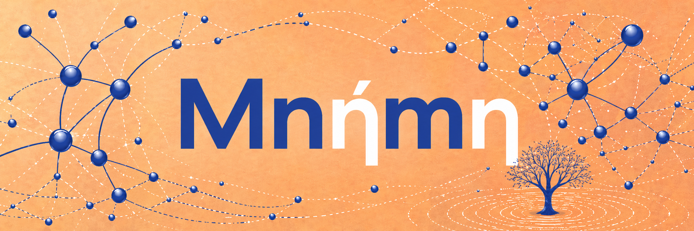

# Mneme



> **Memory should not be a filing cabinet. It should be a nervous system.**

Mneme is a local-first memory layer for AI agents. It senses notes and connected sources, turns evidence into an auditable graph, activates relevant memories, and lets thought travel across trusted synapses.

**Mneme v1.0** is stable, private by default, and built to explain itself.

[](https://github.com/georgeantonopoulos/mneme/releases/latest)
[](https://github.com/georgeantonopoulos/mneme/actions/workflows/ci.yml)
[](pyproject.toml)
[](LICENSE)

## The idea

```text
perceive → connect → activate → think → verify → learn
```

Mneme keeps the machinery local and the reasoning visible:

- **Perceive** Markdown, Gmail, Calendar, Tasks, sessions, and other configured senses.
- **Connect** observations with typed, weighted, source-backed edges.
- **Activate** semantically related neurons with a local embedding index.
- **Think** by spreading activation through active synapses only.
- **Verify** every useful memory against its source and provenance.
- **Learn** through feedback, reinforcement, suppression, decay, and forgetting.

A memory can be related without being true. Candidate and killed synapses never become factual thought paths.

## What ships in 1.0

- Incremental local neuron indexing with Ollama embeddings.
- Associative `think` retrieval with lexical rescue and temporal decay.
- A source-backed SQLite graph for notes, entities, observations, and relationships.
- Durable world state, deterministic predictions, contradiction detection, and an action ledger.
- Full-message Gmail sensing with decoded bodies, thread identity, direction, and attachment metadata.
- Prompt-time retrieval, proactive thought surfacing, explanations, and visual thought cards.
- Safe Markdown editing for agents.
- Privacy scans, deterministic tests, and no required cloud service.

## Quick start

```bash
curl -fsSL https://raw.githubusercontent.com/georgeantonopoulos/mneme/main/scripts/install.sh | bash
```

The installer finishes by opening the setup wizard. It asks three things:

1. **Where are your notes?** A folder of Markdown notes (any notes-app vault works), or a folder laid out
   as `vault/` plus `sources/{email,calendar,chat,tasks}`.
2. **Which model should Mneme think with?** Pick one:
   - Ollama on this computer
   - Ollama Cloud
   - LM Studio
   - any OpenAI-compatible API (OpenRouter, vLLM, ...)
   - a command-line AI such as `claude -p`
   - an agent that answers task files
3. **Check.** It sends one test prompt and saves the setup only if the model answers.

Then:

```bash
mneme learn                          # read your notes into the brain (only new or changed notes next time)
mneme ask "what am I waiting on?"    # an answer, plus the memories it came from
mneme status                         # what the brain holds and which model it uses
```

Everything stays in `~/.mneme` (or `$MNEME_HOME`): the settings (`brain.json`), the brain (`brain.sqlite`),
and a cache of every model answer, so re-running costs nothing.

Requirements: Python 3.10+ and a model (any of the options above). No other dependencies.

To install from a checkout instead:

```bash
git clone https://github.com/georgeantonopoulos/mneme.git && cd mneme
python -m pip install -e .
mneme setup
```

### Installing with an agent

Paste this into Claude Code, Codex, Hermes or any agent with a shell:

> Install Mneme from https://github.com/georgeantonopoulos/mneme and point it at my notes in `~/Notes`
> using Ollama with the `qwen3:8b` model. Then learn the notes and show me `mneme status`.

Every command takes flags instead of prompts and prints one JSON object with `--json`, so an agent can drive
it end to end:

```bash
curl -fsSL https://raw.githubusercontent.com/georgeantonopoulos/mneme/main/scripts/install.sh | bash -s -- --no-setup
mneme setup --notes ~/Notes --mind ollama --model qwen3:8b --yes --json
mneme learn --json
mneme ask "when is the dentist?" --json      # {"answer": ..., "cites": [...], "evidence": [...]}
mneme status --json
```

`--mind` takes `ollama`, `ollama-cloud`, `lmstudio`, `openai` (with `--url` and `--api-key-env`), `command`
(with `--command "claude -p"`), or `file`. With `file`, the agent itself is the model: `mneme learn` writes
tasks to `~/.mneme/mind-files/outbox/`. The agent answers each one with JSON in `answers/`, then runs the
command again. Exit code `2` means tasks are waiting.

### The graph tools

The commands below are Mneme's original graph tools: embeddings, `think` and world state. They are
separate from `setup`, `learn` and `ask`.

#### Build a memory

```bash
mneme init --vault ./examples/vault --db /tmp/mneme.sqlite --out /tmp/mneme-out
mneme doctor
mneme update
```

#### Let it think

For real semantic association:

```bash
ollama pull nomic-embed-text
mneme index --db /tmp/mneme.sqlite --provider ollama --model nomic-embed-text
mneme think --db /tmp/mneme.sqlite --provider ollama --model nomic-embed-text \
  --prompt "What deserves attention?"
```

Indexing is incremental. Repeat `mneme index` after new evidence arrives; unchanged neurons keep their vectors.

For deterministic tests or machines without Ollama:

```bash
mneme index --db /tmp/mneme.sqlite --provider hash --model hash-v1
```

The hash provider is lexical feature hashing, not a semantic substitute.

## The safety model

Mneme is deliberately cautious:

- Every activation retains source provenance.
- Only **active** synapses propagate.
- Candidate relationships remain tentative.
- Killed relationships remain silent.
- Archived and operator-control material cannot re-enter through propagation.
- Semantic similarity creates a lead, never a fact.
- Generated databases, cards, logs, and private source material must stay out of public repositories.

The core graph works offline. Network access occurs only through optional services you configure, such as Google Workspace senses or a remote embedding endpoint.

## Optional Jev decision router

Mneme's traversal is pure math by default: cosine similarity, temporal decay, and synapse strength decide which paths activate. As an **opt-in** extension, you can add a decision-only model (TypeSafe's [Jev](https://docs.typesafe.ai/)) as an advisory router that re-ranks traversal candidates by prompt relevance.

### What it does

- `mneme think --router jev` — after the deterministic activation spread, hop-1 synapse candidates are sent to the router; its picks get an activation boost before the final ranking.
- `mneme agent preflight --router jev` — current world-state assertions are re-ordered by prompt relevance before injection.
- `mneme retrieve --router jev` — prompt-time retrieval items are re-ordered by prompt relevance before budget selection.
- `mneme vault-context-hook` — syncs the generic repo-managed pre-session hook (`scripts/mneme_vault_context_hook.py`) into a Hermes install; the hook uses routed `mneme retrieve` at session start. `--check` verifies sync.

### What it never does

- **Never decides truth.** The router only re-orders and boosts. Provenance checks, candidate-vs-active synapse discipline, and source verification are unchanged.
- **Never mutates the graph.** No edges are created, strengthened, or killed by the router.
- **Never fails loudly.** Missing key, transport error, or low-confidence pick all degrade silently to the standard deterministic ordering — the output includes a `router` report stating what happened.

### Enabling it

```bash
# 1. Configure a TypeSafe API key (choose one)
export TYPESAFE_API_KEY=...              # environment
echo 'TYPESAFE_API_KEY=...' >> ~/.config/typesafe/env   # config file

# 2. Opt in per command
mneme think --db /tmp/mneme.sqlite --prompt "What matters now?" --router jev
mneme agent preflight --db /tmp/mneme.sqlite --prompt "..." --router jev

# Or enable by default for your shell / service
export MNEME_THINK_ROUTER=jev
```

Without a key or with the flag omitted, behavior is identical to previous releases. The router adds roughly one API call (~$0.0003) per enabled command invocation. Get a key at [console.typesafe.ai](https://console.typesafe.ai/).

## More useful commands

```bash
# Collect configured senses
mneme sense list
mneme sense run all --json

# Build prompt-time context
mneme retrieve --db /tmp/mneme.sqlite --prompt "What matters now?"

# Inspect durable state and contradictions
mneme state list --db /tmp/mneme.sqlite --status current
mneme state conflicts --db /tmp/mneme.sqlite

# Preview predictions and attention without mutation
mneme world watch --db /tmp/mneme.sqlite --lead 1d
mneme world tick --db /tmp/mneme.sqlite --dry-run

# Explain and shape future recall
mneme explain THOUGHT_ID --db /tmp/mneme.sqlite --json
mneme feedback THOUGHT_ID --accept --db /tmp/mneme.sqlite --json
mneme forget --db /tmp/mneme.sqlite --days-threshold 30 --dry-run

# Read or update one Markdown section safely
mneme note read Projects/example.md --vault ./examples/vault
mneme note upsert-section Projects/example.md --vault ./examples/vault \
  --heading Status --content "Ready"
mneme note add-bullet Projects/example.md --vault ./examples/vault \
  --heading Tasks --bullet "Follow up"
```

These path-safe note commands stay inside the configured vault and write atomically.

Run `mneme --help` for the complete command map.

## World model

The graph is perception: rich, rebuildable, and sometimes uncertain. The world model keeps the smaller set of things an agent currently trusts:

- **State** — source-backed assertions that survive graph rebuilds.
- **Predictions** — deterministic expectations checked against later evidence.
- **Actions** — external side effects tied to real provider or tool handles.
- **Contradictions** — fresh disagreement stays visible without silently replacing current truth.

Before an agent relies on memory:

```bash
mneme agent preflight --db /tmp/mneme.sqlite --prompt "Should I act on this?"
```

## Google Workspace sensing

Gmail list results are discovery, not evidence. Mneme fetches the full message and preserves:

- normalized headers and sender direction;
- Gmail thread ID;
- decoded plain text or visible HTML;
- attachment names, types, sizes, part IDs, and attachment IDs.

If the detail fetch fails, the discovery row remains available instead of disappearing. Attachment contents are fetched separately.

## Hermes

The repository includes two complementary bundles:

- [`skills/mneme/`](skills/mneme/) — the canonical operating skill for Mneme-aware agents.
- [`skills/mneme-agent-brain/`](skills/mneme-agent-brain/) — the compatibility and readiness harness for Hermes deployments.

A simple local setup:

```bash
git clone https://github.com/georgeantonopoulos/mneme.git ~/.local/share/mneme
python -m pip install -e ~/.local/share/mneme
mkdir -p ~/.hermes/skills
ln -sfn ~/.local/share/mneme/skills/mneme ~/.hermes/skills/mneme
cd ~/.local/share/mneme
python scripts/sync_hermes_hook.py
python scripts/sync_hermes_hook.py --check
```

Use the compatibility harness when a deployment needs the deeper readiness checks:

```bash
MNEME_BRAIN_DEPTH=smoke ./scripts/hermes_brain_ready.sh /tmp/mneme-smoke.sqlite
```

## Architecture

```text
sources
  ↓
sense events → nodes + observations + evidence-backed edges
  ↓
SQLite graph ↔ world state / predictions / actions
  ↓
local neuron index → activation → trusted synapse propagation
  ↓
compact context, explanations, thought cards, feedback
```

The database is plumbing. The public mental model is simpler: neurons wake, synapses carry weight, old signals fade, and every thought can show where it came from.

## Documentation

- [Neural memory](docs/neural-memory.md)
- [Agent-brain architecture](docs/agent-brain-architecture.md)
- [Graph contract](GRAPH_CONTRACT.md)
- [World model](docs/world-model-v1.md)
- [Public/private boundaries](docs/PRIVATE_PUBLIC_DIVERGENCE.md)
- [Changelog](CHANGELOG.md)
- [Security](SECURITY.md)

## Development

```bash
python -m pip install -e '.[dev]'
python -m pytest -q
python scripts/privacy_scan.py
```

Public fixtures are fictional. Never commit a real vault, generated memory database, private thought card, credential, or personal correspondence.

## License

MIT. See [LICENSE](LICENSE).

*Mneme (Μνήμη) means memory. The name is old. The nervous system is new.*
